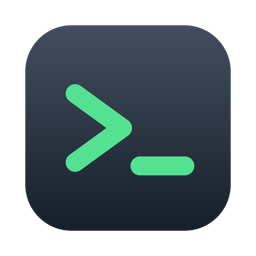

<p align="center"></p>

<h1 align="center">oh-my-openshell</h1>

Portable [OpenShell](https://github.com/NVIDIA/OpenShell) config plus `osh`, a
terminal dashboard for managing gateways, sandboxes, providers, profiles and
images.

Also consumed as a submodule by
[dotfiles](https://github.com/Guilospanck/dotfiles) at `openshell/`. Change it
here, not in the dotfiles checkout.

## osh

```sh
osh            # the dashboard; the first time, a guided screen sets up your gateways
osh doctor     # read-only: what is installed, what is missing
osh setup      # the guided screen again (needs a terminal); or, without one:
osh setup --gateways docker,podman --yes   # the first listed is the main gateway; --dry-run only prints the steps
osh gateway add vm|docker|podman [--yes] [--dry-run]   # one more gateway
osh gateway remove NAME [--delete-data]    # remove a gateway osh created (typed confirmation)
osh upgrade    # reinstall OpenShell, refresh the gateway config, restart the main gateway and its extras
osh gateway-docker          # same as: osh gateway add docker
osh uninstall  # remove OpenShell, its services and folders, osh's own data and the osh program (asks first; sandboxes are lost)
osh gateway-reset NAME      # wipe a gateway's sandboxes and database (typed confirmation)
osh sync-agents --dry-run   # preview what a sandbox would get from your agent setup
```

Install with Homebrew (macOS or Linux):

```sh
brew install Guilospanck/tap/oh-my-openshell   # taps Guilospanck/homebrew-tap on first use
osh setup                                      # then install what osh needs (asks before each step)
```

Homebrew installs only the `osh` binary; it does not install OpenShell, a container runtime or a gateway until you
run `osh setup`. Upgrade with `brew upgrade oh-my-openshell`. To remove everything, run `osh uninstall` (it also runs `brew uninstall` for you); a bare `brew uninstall` removes only the binary and leaves OpenShell, its gateways and osh's data behind. After such a reinstall, `osh` prints a one-time notice that it found that data and is using it. Releases ship
macOS and Linux archives for both aarch64 (Apple Silicon, arm64) and x86_64 (Intel, AMD).

Install from a release (Linux or macOS, aarch64 or x86_64): `curl -fsSL
https://raw.githubusercontent.com/Guilospanck/oh-my-openshell/main/install.sh | sh` downloads
`osh-VERSION-OS-ARCH.tar.gz`, checks its `.sha256`, puts `osh` in `~/.local/bin` and runs `osh setup`
(asking before each step, on the terminal even when piped). Environment: `OSH_VERSION` (release tag; default the
latest), `OSH_BIN_DIR`, `OSH_RELEASE_BASE` (a directory or URL holding the archives; needs `OSH_VERSION`)
and `OSH_NO_SETUP=1` (binary only). Linux archives are built on Ubuntu 24.04 and need glibc 2.39 or newer.

`osh` is a single binary. The provider profiles, sandbox Dockerfiles and gateway
configs are embedded in it and written to `~/.local/share/osh` on first run
(your edits to those files are kept on upgrade, and a file you delete stays deleted; remove `.osh-manifest.json` there to restore the defaults; add your own `images/Dockerfile-*`
and `providers/*.yaml` there). The first time you run `osh` (and with `osh setup`) a guided screen walks you
through it: **Machine** (what was found), **Gateways** (tick the types you want;
each says what it needs and what osh will install for it), **Review** (every
step, with `sudo` marked), **Install** (live progress; `Esc` stops after the step that is running, and the rest are left for the next `osh setup`) and **Done**. Setup
detects the OS and package manager (Homebrew, apt, dnf, pacman, zypper) and
installs OpenShell, the gateway configs and services, whatever each ticked type
needs (Docker Engine, Podman, Colima, a Podman machine, `e2fsprogs`, KVM access),
the `ssh` client on Linux (macOS ships it; `openshell sandbox upload` runs it on your machine, so without it nothing can be uploaded into a sandbox, and `osh doctor` reports it), and the optional tools: `tmux`, `gh` and a clipboard tool. `--runtime docker|podman`
is an alias for `--gateways docker|podman`. On Debian, setup installs Docker from Docker's own apt repository (`docker-ce`, after checking the signing key's fingerprint) instead of Debian's `docker.io`, because `docker.io` 26 cannot copy files into the `--user uid:gid` containers OpenShell creates, so every Docker sandbox would fail to provision; Ubuntu's `docker.io` is new enough and is kept. `osh doctor` reports a Docker server older than 27 as broken for sandboxes and says how to fix it (an existing `docker.io` is never replaced by setup). It never installs silently: each step is shown first, and what
it cannot do for you (no sudo, unknown distro, a stopped Docker daemon) is
printed as the command to run yourself. Without a terminal (a pipe, CI) nothing runs unless you pass `--yes`. Only OpenShell is required to open the
dashboard; image builds need a container runtime.

Release archives: `scripts/release vX.Y.Z [--linux amd64 arm64] [--macos amd64 arm64]` builds them into `dist/` with a `.sha256` each
and prints the `gh release create` command; it never uploads. Pushing a `v*` tag runs the same script in
`.github/workflows/release.yml` (one runner per platform, then publish), which has not yet run on GitHub.

Releasing from this machine, the same steps as the workflow plus the Homebrew formula: `just release-setup`
(read-only check of `gh` login, push access to the tap, Docker, Zig), then `just release-dry-run vX.Y.Z` (check,
`just release-gate`, version bump, archives, formula lint; pushes nothing, reverts the bump), then `just release vX.Y.Z ["notes"]`
(commits the `tui/Cargo.toml` bump, tags, pushes, `gh release create`, pushes `Formula/oh-my-openshell.rb` to
`Guilospanck/homebrew-tap`). It needs a clean `main` level with `origin`, and never runs `osh` or `osh setup`.
On Apple Silicon the Linux archives build in a separate Colima instance (`scripts/release-colima`; needs
`colima` and `lima`), created for the run and deleted after it (`--keep-vm` keeps it, `--host-docker` uses your own
Docker instead); your own Colima is not touched. Nothing is emulated (under QEMU the linker crashed): the container
runs at the engine's own architecture and cross-compiles the other Linux archive with Ubuntu's cross gcc, and the Mac
cross-compiles the other macOS one, which needs `rustup target add x86_64-apple-darwin` once (`just release-setup`
checks it). Users then run `brew install Guilospanck/tap/oh-my-openshell`; the formula installs only the binary, and
a platform without an archive gets no block.
`just release-gate` runs the container suites (distro build and setup, real Linux with podman and docker,
including the sandbox terminal and tmux checks) and `just release` stops if any of them fails; there is
no flag to skip it.

`just release-setup-ci-key` is the one-time deploy key (stored as the repo secret `HOMEBREW_TAP_DEPLOY_KEY`) the workflow uses to push the tap; once Actions run again, release by pushing the tag only, since `just release` also creates the GitHub release and would make the workflow fail. From a
checkout, `./osh` is a launcher that builds the TUI with cargo when its sources
change and sets `OSH_DIR` to the checkout, so edits to the repo's providers and
Dockerfiles apply with no copy. Build needs `cargo` and Zig 0.15.

The embedded sandbox shell uses libghostty-vt (Ghostty's terminal engine),
which builds only with Zig 0.15 (`brew install zig@0.15`). The launcher puts
`zig@0.15` on PATH for the build; building by hand needs
`PATH="$(brew --prefix zig@0.15)/bin:$PATH" LIBGHOSTTY_VT_SYS_OPTIMIZE=ReleaseFast cargo build --release`.

Two keys help you find your way on any tab: `?` opens the key reference for the tab you are on, and
`:` (or `Ctrl-P`) opens the command palette, where you type a few letters of any action (`del`, `go to g`) and
press `Enter` to run it. The palette sends the action's own key, so it does exactly what the key does.
A few actions have no key and live only in the palette:

| Palette action | What it does |
| --- | --- |
| `Edit toolchains.toml` | opens the list of toolchain hosts in your editor, or the built-in one (below) |
| `Editor: switch auto / your own / built-in` | which editor the edit actions use: `auto` (yours when one is found, else the built-in one), always yours, or always the built-in one (kept across runs in `editor-mode` in the data folder) |

| Tab | What you can do |
| --- | --- |
| Sandboxes | create (`n`), open a shell inside osh (`Enter`; `Ctrl-]` for the menu, `●` marks a running one), delete (`d`), stop/start (`s`/`S`), attach/detach providers (`a`/`x`), live logs (`l`), blocked requests (`p`), renew a repo token (`t`), install skills and plugins (`K`, below), transfer state to another sandbox (`T`: copies the home directory, workspace and tool caches through a temp folder on the host; same-path files are overwritten; system packages cannot move, so put those in the image) |
| Providers | create from a `providers/*.yaml` profile or a read/write repo token for GitHub, GitLab, Bitbucket or Forgejo (`n`), update credentials (`u`), delete (`d`) |
| Profiles | import or refresh a profile on the gateway (`u`) |
| Images | build `images/Dockerfile-*` (`b`); shows when a build is outdated (creating a sandbox from an outdated image asks whether to rebuild it first, since a sandbox keeps the image it was created from) |
| Gateways | switch (`g` / `Enter`), make one the OpenShell CLI default (`s`), add a gateway (`a`), remove one osh created (`x`), wipe and restart empty (`d`) |

Credentials are read from the environment when exported, else prompted hidden;
they never go through argv. The footer shows the keys for the current tab.

### Editing files

Every "edit this file" action opens your own editor inside osh's terminal (the one sandbox shells
use), full screen above a status bar, so osh keeps running and its alerts still show. The editor is
`$VISUAL`, else `$EDITOR` (arguments and quotes are split as a shell would, without running one,
so `EDITOR="code --wait"` works), else the first of `nvim`, `vim`, `nano`, `vi` on `PATH`; a
variable naming a program that is not there is skipped. osh hands the editor a copy of the file in
a private temporary folder (mode 0700, the file 0600, with the real file name so the editor picks
the syntax), and when the editor exits it reads the copy back: unchanged, or an editor that exits
with an error, writes nothing; otherwise the file's check runs (the same checks as below) and only
a file that passes replaces the real one. When the check fails a box shows the first line of the
error; `Enter` or `r` reopens the editor on your edits, `d` discards them. The temporary folder is
removed afterwards in every case. When no editor is found, or it does not start, osh opens its
built-in editor instead and its status bar says why. The palette's `Editor: switch auto / your own
/ built-in` forces one or the other (with "your own" forced and none found, osh says so and opens
nothing).

### Built-in editor

The fallback editor runs inside the TUI with no outside program.
Edit actions open it (when your editor is not used) with `Edit toolchains.toml` from the command palette (`:`) or from the toolchain pickers
(new sandbox, and `Open the toolchain hosts` in the `Ctrl-]` menu; after either editor closes the picker comes
back with the fresh groups), on any file under `Data files` or `Sandbox policy`, with `e` / `n` on the
Profiles and Images tabs, and with `e` on the Gateways tab. Saving checks the file first:
`toolchains.toml` must parse as TOML with exact host names, `sandbox-policy.yaml` must be YAML with a
`version`, a profile must be YAML with an `id` and pass OpenShell's `profile lint`, a Dockerfile must
start with `FROM`, other TOML and YAML files must parse; when it does not, nothing is written, the status bar shows the first line of the error and the
cursor jumps to the line it names, so you fix it and save again. Closing with unsaved changes asks
whether to save, discard or keep editing.

| Key | What it does |
| --- | --- |
| `Ctrl-S` | Save (the file is checked first; a broken file is not written) |
| `Esc` / `Ctrl-Q` | Close; asks to save or discard unsaved changes (`Esc` first clears a selection) |
| Arrows, `Home` / `End`, `Ctrl-A` / `Ctrl-E` | Move; `Home` goes to the first non-blank, then the line start |
| `Ctrl-Left` / `Ctrl-Right` (`Alt-b` / `Alt-f`) | Word left / right |
| `PgUp` / `PgDn`, `Ctrl-Home` / `Ctrl-End` | Page; file start and end |
| `Shift` + any move | Select; `Ctrl-Space` sets a mark so plain moves select; `Alt-a` selects all |
| `Ctrl-C` / `Ctrl-X` / `Ctrl-V` | Copy, cut, paste; with nothing selected they take the whole line |
| `Ctrl-Z` / `Ctrl-Y` | Undo / redo (a run of typing is one step) |
| `Ctrl-K` / `Ctrl-W` (`Alt-Backspace`), `Alt-d` | Cut to the line end; delete the word before / after |
| `Enter`, `Tab` / `Shift-Tab` | New line with the same indent; indent / outdent by two spaces (the selected lines too) |
| `Ctrl-F`, then `Ctrl-N` / `Ctrl-P` (or `F3` / `Shift-F3`) | Find as you type (a capital letter makes it case-sensitive); next and previous, wrapping |
| `Ctrl-G` | Go to a line, or `line:col` |

Copy also puts the text on your computer's clipboard (OSC 52 through the terminal, plus `pbcopy` on
macOS, as the shells do); `Ctrl-V` pastes the editor's own clipboard, and your terminal's paste
(`Cmd-V`) arrives as one paste. Wide and combined characters count as the columns they take.

### Embedded shells

Alerts (`!` lists them): osh warns, in a box at the top-right that goes away after 5 seconds (`Esc`
dismisses it), when you pick a risky folder to share (the whole disk, your home folder, `~/.ssh`, a system
folder) and, for read-write shares, when something appears or changes in the folder that would run on
this machine later: `.git/hooks`, `.git/config` keys that run programs, `.envrc`, `Makefile`, `justfile`,
`package.json` scripts, `.vscode/tasks.json`, shell startup files, symlinks that point outside the
folder, and setuid files. The folder is checked every few seconds; the first check is the baseline.
Every alert also stays in the list and in the shell menu (`Alerts (n)`). Alerts belong to the sandbox that mounts the folder: inside a shell you see only that sandbox's alerts and blocked-request prompts (other sandboxes' prompts wait until you open their shell); the dashboard shows all. Folders recorded by older osh versions have no sandbox and show on the dashboard only.

`Enter` on a sandbox opens `bash` in it, inside osh. When the image has `tmux`
(the Claude Code image does) the shell runs in a tmux session named `osh`, and opening the
shell again reattaches to it; this is what `workmux` and `/orchestrate` need. New sandboxes are
created with `sandbox-policy.yaml`: the whole filesystem is writable inside the sandbox (network,
credentials and the shared folder are what keep it from the host), which also lets tmux open a
terminal, something OpenShell's default policy denies. Sandboxes made before
this need to be recreated; until then the shell falls back to plain `bash`.
When `workmux` hooks run in the sandbox (`workmux set-window-status` in the sandbox's Claude
settings), osh mirrors the most urgent state of its shells (waiting, working, done) onto its own
tmux window with the host's `workmux set-window-status`. The shell's bar also shows the git branch of the
shell's current directory (read by the sandbox's tmux, so it follows `cd` and `git switch`, refreshed every 5 s); it needs osh itself to run in tmux with
`workmux` on the host. Every key goes to the
shell, host tmux shortcuts included: when osh runs in tmux, the host's prefix and root-table bindings
(`M-h`, new tab, ...) are wrapped as "if this window is an osh shell with focus, send the key to the
pane, else run the original", so they reach the tmux inside the sandbox only in that window and the rest
of the host session keeps its shortcuts (needs tmux 3.2+; `Ctrl-]` still leaves the shell). While osh runs, the host's global `prefix` is `None` and the
prefix key is a wrapped root binding; osh puts it back when it quits. `OSH_TMUX_PASSTHROUGH=0`
turns this off. After a crash, `tmux set-option -g prefix "$(tmux show -gv @osh_prefix)"` restores the prefix. A new sandbox gets your host `tmux.conf` automatically when its image has tmux (secret-scanned first), and a filtered copy of your global git config (only aliases, colours and a few behaviour keys such as `init.defaultBranch`, `push.default`, `pull.rebase`; never credentials, URLs rewrites, signing, editor or hook settings) in `~/.config/osh/gitconfig`, included from the sandbox's `~/.gitconfig` (an existing one is kept; osh's own git identity and credentials still win); resend the tmux one later with `K` (sync agents); `Ctrl-]` opens a menu: back to the session, the providers attached to the sandbox and what
each allows (credentials, hosts and access level, binaries; scroll with `j`/`k`), the blocked requests
seen in the sandbox (same list as `p`, below), dashboard (the shell keeps
running, marked `●`; `Enter` on it returns), or close it. Shells keep their
size when the window resizes, focused or not. `Shift-PgUp`/`PgDn` and the
mouse wheel scroll back on the main screen; programs that ask for the mouse
(vim, `less --mouse`) get it.

Under tmux, `Shift-Enter` reaches the shell when tmux has
`set -g extended-keys on` (or `always`) and `set -g extended-keys-format csi-u`:
tmux does not answer the kitty keyboard query, so while a shell has focus osh
asks tmux for modifyOtherKeys instead. The `xterm` format is not used (osh's
input library cannot read it); there `Shift-Enter` arrives as `Enter`.

`Alt` works as Meta (sent as an `Esc` prefix: `Alt-b`/`Alt-f` move by word in
bash). On macOS the host terminal must send it, e.g. "Use Option as Meta key"
in Terminal.app or "Esc+" for Option in iTerm2; that setting is outside osh.

### Blocked requests

While a sandbox has a shell open, osh follows its logs. When the network
policy blocks a program from reaching a host, a prompt opens (over the shell,
or the dashboard): `curl was blocked from reaching example.com:443`, with
allow read-only (GET/HEAD/OPTIONS) or all methods for that program to that `host:port` only, ignore this time,
ignore until the session ends, or never allow that `host:port` in this sandbox
(any program; saved in `~/.local/state/osh/never`, and `p` then Enter asks
again). When a profile in `providers/` (no credential needed) declares the
blocked host, the first choice is `Attach the <profile> provider (recommended)`:
the profile carries details a plain allow cannot, such as `npm`'s encoded
slashes for scoped packages. For other hosts, a request rejected for an encoded
`/` (`@scope%2fname`) opens a prompt to allow encoded slashes: osh replaces the
ad-hoc rule with a generated `slash-<host>` provider for that host and program.
Requests cut off by a policy reload (`policy generation is stale`) are
not shown. Allowing adds exactly that `host:port` for
exactly that binary to the running sandbox (`openshell policy update
--add-endpoint host:port:read-only:rest:enforce` or `host:port:full`); the
result shows in the status bar: a seconds counter while the sandbox loads the rule, then
`Allowed ...; it is live, ask again` (kept for 20 s). The request that was blocked is not retried;
ask the tool again once it shows. Denials that a host rule cannot fix (an L7
rule rejecting the request) show a notice with the reason instead. `p` on the
Sandboxes tab, or `Blocked requests` in the `Ctrl-]` menu of a shell, lists what was seen in
the sandbox and stays open, adding new denials as they arrive (the prompt does not cover it
meanwhile); `Enter` on an entry asks again with the choices above.

### Forwarding a server to your computer

While a shell is open, osh polls the sandbox's TCP listeners every 3 seconds. When a program
starts listening on a new port (a web server, a served page), a prompt asks
`Port 8000 started listening: forward it to this computer?` with `Forward to localhost:8000`,
`Forward to localhost:8000 and open the browser`, `Not now` (`Esc`; asks again if the port
closes and opens again) and `Ignore this port until the session ends`. Forwarding runs
`openshell forward start -d PORT SANDBOX`, so the page is at `http://localhost:PORT`; the host
port is the sandbox's port, and osh refuses when something on your computer already uses it.
Ports already listening when the shell opens, the policy proxy (3128) and listeners bound to one
other interface are not offered. osh stops its forwards when the port closes or the shell closes.

`Port forwards (n)` in the `Ctrl-]` menu of a shell works at any time, without waiting for a
prompt: it lists the forwards osh runs for the sandbox (`Stop forwarding localhost:N`), the ports
now listening there that are not forwarded (`Forward port N`), and `Forward another port...`,
which asks for a port number.
Prompts follow the same rule as blocked requests: a sandbox's offers wait until its shell has focus.

### Selection and copy

Drag with the left button to select text in a shell (hold `Shift` when the
program uses the mouse). Releasing copies it through the terminal (OSC 52;
under tmux that needs `set -g set-clipboard on`) and `pbcopy` on macOS, and
the status bar shows `copied N chars`. The selection stays on its text while
you scroll (wheel, `Shift-PgUp`) or new output arrives, so it can span more
than one screen; text dropped from the scrollback drops it. `Esc`, typing or a
click clears it.

### Clipboard between host and sandbox

**Sandbox to host.** When a program in the focused shell copies text (OSC 52,
as Claude Code does), osh puts it on the host clipboard the same way a drag
does and shows `sandbox copied N chars`. Only plain text up to 1 MiB from the
shell in front is taken; clipboard reads and background shells are ignored.
A program in the sandbox can overwrite your clipboard this way, so check what
you paste into a host terminal.

**Host to sandbox (images).** `Ctrl-V` in a shell with an image on the host
clipboard (a screenshot, say) uploads it as a PNG to `~/.osh-paste/` in the
sandbox and types its path, which Claude Code and other agents that take image
paths attach as an image. With no image on the clipboard, `Ctrl-V` goes to the
shell as usual. The clipboard is read only when you press it, images over
20 MiB are refused, the host copy lives in a private temp directory only for
the upload, and the sandbox copies are deleted when the last shell for that
sandbox closes. The host needs `pngpaste` (macOS; `osh setup` installs it),
`wl-paste` (Wayland) or `xclip` (X11).

## Gateways

A gateway is where sandboxes run, and each is named after its type: `openshell-vm`,
`openshell-docker`, `openshell-podman`. You can have several side by side, on
macOS and on Linux. The first one you create is the **main** gateway (port 17670, the
one the CLI uses by default); the others get the next free ports (17671 and up). Each gateway also uses the port +10 (health) and +20 (metrics).

| Type | What it is | Needs |
| --- | --- | --- |
| VM | each sandbox in its own microVM; strongest isolation, fixed size per VM | macOS: `e2fsprogs`. Linux: `/dev/kvm` usable by your user (osh adds you to the `kvm` group and asks for a new login) and `e2fsprogs`; unavailable, with the reason, where there is no KVM |
| Docker | sandboxes as containers; honours per-sandbox CPU/memory | Linux: Docker Engine, the `docker` service, your user in the `docker` group (new login). macOS: Colima (installed and started) or Docker Desktop (you start it; untested) |
| Podman | like Docker, daemonless and rootless | Linux: `podman` and its user `podman.socket`. macOS: `podman` and a Podman machine (created and started) |

The Gateways tab lists them with their type and port. `a` adds one (the same screen,
showing only the types you do not have), `x` removes one osh created, `d` wipes one.
The main gateway cannot be removed while others exist. A gateway you had before osh
managed it (for example `openshell` or `openshell-docker` from an older setup) is left
exactly as it is: it is listed, can be selected and wiped, but osh will not rename,
reconfigure or remove it. One repair is the exception: the `openshell-docker` launchd agent an
older `just gateway-docker` set up runs a script osh no longer ships, so `osh setup`, `osh upgrade`
and `osh gateway-docker` point it at `osh gateway-service docker` (same config, database and
logs) and start it again; any osh launchd agent whose program is gone is repaired the same way.

osh keeps each gateway's config in `~/.local/share/osh/gateways/NAME.toml` (edit it; your
changes are kept). The main gateway on Linux, and the VM main on macOS, use OpenShell's own
`gateway.toml` instead: osh rewrites it when it differs from what it would write and keeps the
previous copy next to it as `gateway.toml.osh-bak` (then `.osh-bak.1`, `.2`, never overwriting
an earlier one). osh remembers the ones it made in `gateways.json` there. Extras run as
a systemd user unit `osh-gateway-NAME` (Linux) or a launchd agent (macOS); the main runs as
OpenShell's own service (on macOS a Docker or Podman main runs as its own launchd agent
instead of the Homebrew service). Logs on Linux:
`journalctl --user -u openshell-gateway` or `-u osh-gateway-NAME`. Providers and
profiles are per gateway. The Podman and VM gateways have only been tested up to a
connected gateway on Linux, never booting a real microVM, and nothing here has run
on a real Linux desktop.

## Claude Code provider

1. `claude setup-token` on the host and export `CLAUDE_CODE_OAUTH_TOKEN`.
2. In `osh`, Providers, `n`, pick `claude-code`.
3. Create a sandbox with that provider and attach.

The real token stays outside the sandbox; only `api.anthropic.com` is
allowed. Tokens expire and are not refreshed: generate a new one and use `u`
in Providers.

## Skills and plugins in a sandbox

In `osh`, Sandboxes, select a sandbox and press `K`: pick the agent
(`claude-code`, `pi` or `both`), mark the items, and confirm. The TUI checks
the sandbox's network policy first and lists any missing access. Items are
reinstalled from their sources (`npx skills`, `claude plugin install`,
`pi install`, graphify from PyPI); only your own skills, `CLAUDE.md` and your host `tmux.conf`
(to `~/.tmux.conf` in the sandbox, so its tmux has your prefix and bindings) are
uploaded, after a secret scan (findings block the upload). The OpenShell skills
and the language-server plugins are left out. Versions are pinned: the `skills`
CLI to `SKILLS_CLI` in `tui/src/agents.rs`, graphify to the host's version, and
superpowers for pi to the commit installed on the host.

If the sandbox's policy blocks an install, `K` offers to create (if needed) and attach the anonymous profiles that grant the access, then checks again. The profiles are: `npm`, `pypi`
(graphify) and `claude-marketplace` (read-only github.com for plugins, `npx
skills` and `pi install`). You can also create them from the Providers tab. Preview the list
with `osh sync-agents --dry-run`.

Opt-in profiles, attached on purpose from the Providers tab (never by `K`):
`rust` (cargo and rustup: both the launcher in `~/.cargo/bin` and the real toolchain
binaries, crates.io, rust-lang.org, git dependencies), `go` (module proxy and checksum
database), `js` (npm, pnpm, yarn, bun; same registry shape as `npm`, so both attach
together). A blocked-request prompt offers
`rust` or `go` when the blocked host is one of theirs and no ordinary profile covers it.

Toolchain hosts: `toolchains.toml` in the data directory (edit it inside osh: `Edit toolchains.toml`
in the palette or in either toolchain picker, see [Editing files](#editing-files)) lists exact hosts, in groups, that every
new sandbox may read from its first command (GET/HEAD/OPTIONS by any program, so installs do not
fail once per host). `github`, `go`, `rust`, `zig`, `node` and `python` are on; `gitlab-codeberg`,
`java`, `ruby`, `php`, `dotnet`, `elixir` and `playwright` are off. Edit the file to switch a group
(`[java]` then `enabled = true`), add hosts, or move a git host to `git_hosts` (adds the `POST /**/git-upload-pack` that
clone and fetch need; pushes stay denied). osh keeps your edits. The list goes into the
`--policy` file given to `sandbox create`, inside the `network_policies` block of `sandbox-policy.yaml`
when you added one there (a one-line block cannot be added to: the create question says the hosts were
left out, and why). Creating a sandbox asks which groups it may read from
(marks start at the file; the last line, `Save this choice as the default`, writes them back to the
file, so groups can be switched without leaving `osh`; the line after it, `Edit toolchains.toml`, opens the
file in your editor (or the built-in one) and brings the picker back with the saved groups). Hosts that are not exact
names (wildcards, addresses) are refused by the file's check and named in the status line. When the file is not
valid TOML or has no group, both pickers say why and offer the editor (a new sandbox can also go on
without the list). For a running sandbox use `Open the toolchain
hosts` in the `Ctrl-]` menu: it asks which groups, and adds the rules with `policy update` (never `policy set`, which would
drop rules you allowed since). Some entries are wide on purpose: `storage.googleapis.com` reaches
any Google Cloud Storage bucket and the `githubusercontent.com` hosts serve anyone's files, but
Go modules and GitHub releases cannot be fetched without them. Where a provider profile defines
the same host, the list narrows it to read-only for that host. `registry.npmjs.org` carries the npm profile's `allow_encoded_slash` setting in the creation policy (a mismatch makes OpenShell reject the provider attach); `policy update` cannot set it, so `Open the toolchain hosts` skips that host: attach the `npm` or `js` profile, or answer the prompt.

For open-ended research ("any website") there is no profile, because OpenShell refuses `*`
hosts. Instead, when `curl` or Claude Code is blocked on a web host (ports 80/443), the prompt
offers "Allow web reads ... until the session ends, no more prompts". The same prompt offers
"by any program ... always": every program, HTTP ports 80/443, read-only, and the whole registrable domain of the blocked host with its subdomains at once (`dl.google.com` opens `google.com` and `**.google.com`; if OpenShell refuses that, osh allows the exact host), kept for that sandbox
only in `~/.local/state/osh/auto_any` (the prompt then offers "Stop auto-allowing" for it). From then on, until that
sandbox's shell closes, osh answers every such denial for those two programs with the same
read-only allow you would have picked (one `policy update` at a time, no popups). The first
request to each new host still fails once; the retry works. Reads can carry data out in a URL,
so use it only in a sandbox without secrets worth stealing. Other programs and write methods
still ask.

When access is missing, `K` offers either the built-in profiles above or a
generated one: `osh sync-agents --gen-profile` writes a profile that grants only
the hosts and programs still missing (no credential), shows you a summary,
asks for a name (default `install-<sandbox>`), then imports it, creates the
provider and attaches it. After the installs it offers to detach and delete
it, since the network is only needed while installing. This also avoids the
attach conflicts between built-in profiles; if an attach still fails, it is
removed again instead of left on the gateway.

Profiles that need a secret (for example `github`, for private skill sources)
are offered the same way. For a GitHub token, `osh` offers to read it from
`gh auth token` on the host (never shown, never on a command line), or you can
paste one (hidden; use a fine-grained, read-only token from
github.com/settings/personal-access-tokens/new). Tokens exported in the shell
that started `osh` are used without asking. As with Docker Sandboxes, the
real secret stays on the host. The gateway refuses to attach a provider whose
endpoints it cannot merge with those already attached: a credentialed endpoint
(`github` injects its token on `github.com` and `api.github.com`) next to a
profile that allows the same host uninspected, or two inspected (`rest`)
entries for one host that differ in `enforcement` or `allow_encoded_slash`.
`pypi` therefore gives `github.com` and `api.github.com` the same inspected
shape as `github`, so the two attach together (re-import `pypi` on gateways
that have the old one). When an attach is refused during `K`, osh lists the
attached providers and offers to detach one and try again.

The installs run in your terminal and stop at the first failing step. osh then
says which step failed and shows the end of its output (recorded with
`script`, so the steps keep a real terminal). When that output reads like
GitHub refusing access (a private repository: `Repository not found`,
`could not read Username`, `Authentication failed`), it offers to create or
attach the `github` provider and run the installs again from that step. The
policy check cannot predict this: it is not a network block.

### GitHub read/write access to a repo

When a new sandbox shares a folder (`n`, "Share a host folder?") whose `origin`
is a GitHub repository, the wizard asks about GitHub access to it: none,
read-only (the `github` provider), an existing repo provider, or read and
write with a new fine-grained token. For read/write osh shows the steps and
opens GitHub's token page with the owner, a 30 day expiry and the permissions
(Contents, Pull requests and Workflows: Read and write) filled in. GitHub cannot
preselect the repository, so the steps tell you to choose "Only select
repositories" and pick it (Workflows is needed to push
`.github/workflows`; an organization may have to approve the token first). Paste the token (hidden);
osh checks it can see the repo before using it.

osh then imports a profile `gh-<owner>-<repo>`: the `github` profile's read
access plus `POST .../<owner>/<repo>.git/git-receive-pack`, so pushes reach
that repo only. The token lives in a provider created from it: `github-<sandbox>-<repo>`
for one sandbox, or `github-<repo>` when you pick "shared by sandboxes" (also
`n` on the Providers tab, "Git repo, read/write"; attach it to other
sandboxes with `a` or pick it in the wizard). A sandbox's own provider is deleted
with the sandbox, and osh then offers to open GitHub's token list and names the token to delete there
(GitHub has no API for that); a shared one stays until you delete it.

Tokens expire after 30 days. The Providers tab shows the repo and time left
(yellow in the last 7 days), and a yellow banner under the tabs names the
soonest token to expire (or already expired) on every tab. Renew with `u` on
the provider, or `t` on a sandbox: osh shows the steps again and swaps the new
token in, then offers to restart the running sandboxes that have the provider
attached (stop and start: running programs end and `/tmp` is cleared, files in
`/sandbox` are kept), since programs already running keep the old token. The expiry is
kept in `~/.local/state/osh/tokens`; the token itself never touches argv or
that file. Shells opened by osh set `GIT_CONFIG_*` variables: `git@github.com:`
remotes use HTTPS, because the provider only reaches `github.com:443`, and a
credential helper gives git the provider's token as `x-access-token:<token>`
(GitHub accepts Basic auth for git, not Bearer; the gateway swaps the real
secret in). Without the helper git sends no credentials and fails with `could
not read Username`. The repo's `.git/config` on the host is not changed, and
programs that did not start in an osh shell (for example another `exec`) do not
get this setup.

### Repo access per git provider

When the shared folder's `origin` is on another host than `github.com` (https,
ssh or `git@HOST:` form), the wizard asks once "Which git provider hosts
HOST?": GitHub, GitLab, Bitbucket, Forgejo, or "None / other (no repo
access)". The likely one is first (`gitlab.com` GitLab, `bitbucket.org`
Bitbucket, `codeberg.org` Forgejo, else GitHub). The answer, "none" included,
is kept per host in `~/.local/state/osh/git-hosts` (with the remote's ssh port,
when not 22), so it is never asked again; hosts an earlier osh remembered as
Forgejo in `forgejo-hosts` still count as Forgejo, and hosts answered "no"
there are asked again. Bitbucket on `bitbucket.org` is Bitbucket Cloud; on any
other host it is Bitbucket Data Center. GitHub is supported on `github.com`
only.

Then come the same choices as for GitHub: none, read-only where osh ships a
read-only profile (`github`, `forgejo`, with the host filled in; GitLab and
Bitbucket have none), an existing provider of the repo's profile, or read and
write with a token for this sandbox or one shared by sandboxes. On the
Providers tab, `n`, "Git repo, read/write" takes `OWNER/REPO` (GitHub) or
`HOST/PATH` as in the clone URL, and asks a new host's provider the same way.

| Provider | Token | Where osh sends you | Permissions | Expiry | Caveats |
| --- | --- | --- | --- | --- | --- |
| GitHub | fine-grained personal access token | prefilled `github.com/settings/personal-access-tokens/new` | Contents, Pull requests, Workflows: read and write; only the selected repo | 30 days, tracked | an organization may have to approve it |
| GitLab (any host) | project access token, role Developer | `https://HOST/GROUP/.../REPO/-/settings/access_tokens` (name and scopes in the URL; the steps do not rely on it) | `read_api`, `write_repository` | 30 days, tracked | on gitlab.com project tokens need Premium or Ultimate; on Free use a personal access token with the same scopes, which reaches every project your account can |
| Bitbucket Cloud | repository access token | `https://bitbucket.org/WS/REPO/admin/access-tokens` (Repository settings > Security > Access tokens) | Repositories: Read, Write | 30 days if the workspace lets you choose; tracked as 30 days | app passwords no longer work |
| Bitbucket Data Center | repository HTTP access token | `https://HOST/projects/PROJ/repos/REPO/settings`, then HTTP access tokens | Repository write | 30 days if offered; tracked as 30 days | https on port 443 with no context path only: `https://HOST/scm/PROJ/REPO` or `ssh://git@HOST:PORT/PROJ/REPO` |
| Forgejo | access token | `https://HOST/user/settings/applications/tokens/new` | Specific repositories: the repo; scope `write:repository` | none, not tracked | delete it yourself when no sandbox needs it |

osh checks a pasted token with a read-only GET before using it (GitLab
`/api/v4/projects/<encoded path>` with `PRIVATE-TOKEN`, Bitbucket Cloud
`api.bitbucket.org/2.0/repositories/WS/REPO`, Data Center
`/rest/api/1.0/projects/PROJ/repos/REPO`, Forgejo `/api/v1/repos/OWNER/REPO`,
all others as bearer; the token goes through a private header file, never
argv). Read/write imports a profile `gl-`, `bb-` or `fj-<host>-<owner>-<repo>`:
API reads (Bitbucket Cloud on `api.bitbucket.org`, read-only), git clone and
fetch, and `POST .../git-receive-pack` for that repo only (under `/scm/` on
Data Center), for `git` and `curl` only. Providers are `gitlab-`,
`bitbucket-` or `forgejo-<sandbox>-<repo>`, or `...-<repo>` when shared, with
the token in `GITLAB_TOKEN`, `BITBUCKET_TOKEN` or `FORGEJO_TOKEN`. GitLab and
Bitbucket tokens are tracked and renewed like GitHub's (`u`, `t`, banner).
Deleting a sandbox removes its own repo provider and names the token and the
page to delete it on.

Shells opened by osh also rewrite ssh remotes of every remembered GitLab,
Bitbucket and Forgejo host to https (Data Center `ssh://git@HOST:PORT/` to
`https://HOST/scm/`) and add a credential helper per host that gives git the
token placeholder with the username the provider expects (`oauth2` for GitLab
and Forgejo, `x-token-auth` for Bitbucket). Only GitHub's git-over-HTTPS path
has been tested through the gateway; GitLab, Bitbucket and Forgejo follow their
documentation and are untested against live services.

## Development and agents

`AGENTS.md` (also `CLAUDE.md`, a symlink) tells coding agents how to build,
test and change the repo. For humans: `just doctor` checks the prerequisites,
`just check` runs format, clippy and tests (needs only `cargo` and Zig 0.15),
and a bare `just` lists the recipes. Both build on macOS and Linux (Zig 0.15 on
PATH, or `brew install zig@0.15` with Homebrew or Linuxbrew). The Linux
install, uninstall and gateway-reset paths follow OpenShell's packaged systemd
service. `just test-sandbox` runs the real-Linux machine below, which also drives the dashboard key by key in a
pseudo-terminal (`tests/e2e`: every key in the footer has a scenario, listed in `tests/e2e/actions.txt`), and, in it only, creates a sandbox and checks a
terminal, tmux and writes work. `just test-linux` checks them in Docker (Debian, Ubuntu, Fedora, Arch) with real
package installs and stubbed OpenShell and systemd, and `just test-linux-real
podman|docker|vm` in a systemd container with nothing stubbed (vm needs /dev/kvm
on the Docker host and is skipped without it); they have not run on a real Linux
host. `just test-macos` runs the macOS paths on a Mac against recording stand-ins
for Homebrew, launchd, Colima and Podman without changing the Mac, and
`just test-release` runs the release workflow's Linux jobs with act. On a Mac,
with disposable VMs that are deleted afterwards: `just test-linux-kvm` runs the
VM gateway scenario on real KVM (a separate Colima instance with nested
virtualization, M3 or later; its sandbox checks show as KNOWN-FAIL while OpenShell
bug [#4014](https://github.com/NVIDIA/OpenShell/issues/4014) stops every microVM
sandbox at start), `just test-macos-vm` runs real Homebrew,
`brew services` and launchd in a Tart macOS VM clone, and
`just test-macos-runtimes` runs osh's real Colima and Podman machine steps in a
throwaway HOME, leaving your own Colima untouched. Docker Desktop is not tested.

## Setup without the dashboard

Everything above runs from the shell (`osh setup`, `upgrade`, `uninstall`,
`gateway add|remove`, `gateway-docker`, `gateway-reset`). The justfile keeps thin developer wrappers for
them (`just install`, `upgrade`, `uninstall`, `gateway-docker`, `tui`) and
`just install-hooks` (below). Run recipes with `just --justfile .justfile <recipe>`.

## Secret and PII hook

`just install-hooks` (once per clone) enables a pre-commit hook that scans the
whole staged snapshot with [Gitleaks](https://github.com/gitleaks/gitleaks)
(`brew install gitleaks`) and refuses `.env` files. Rules live in
`.gitleaks.toml`. A missing scanner or scan error blocks the commit.

## License

[MIT](LICENSE).
